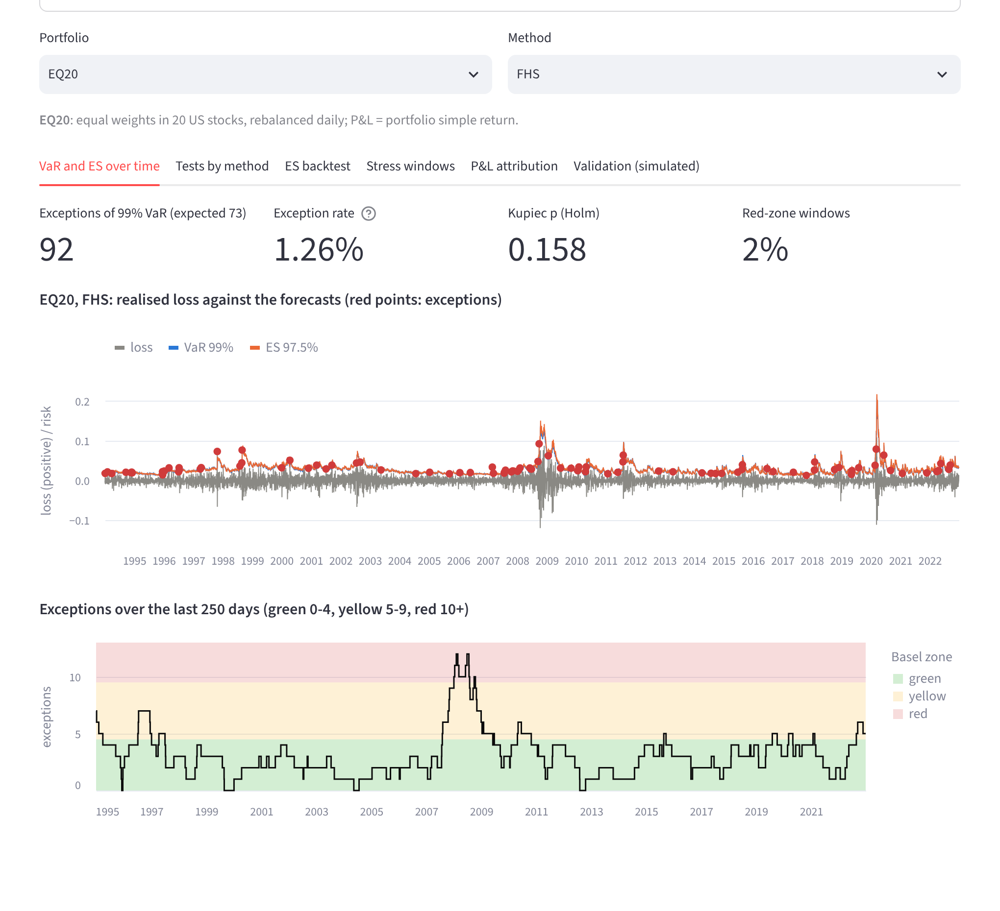
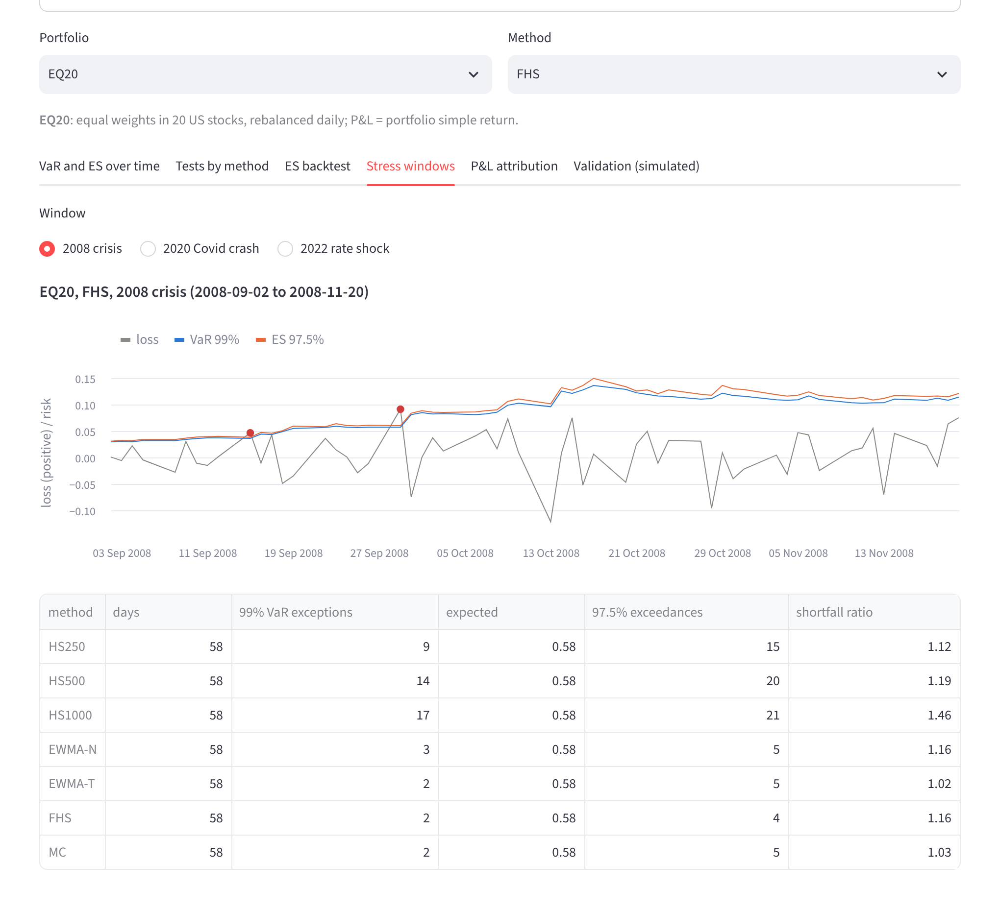

# Market Risk Engine: VaR, Expected Shortfall and Backtesting

A small Python library that forecasts one-day 99% value-at-risk (VaR) and 97.5% expected
shortfall (ES) with seven methods, revalues option positions in full, and backtests the forecasts
with coverage, independence, ES and scoring tests. It was validated first on simulated data with
known truth and then backtested on real data under a protocol fixed before any real-data run.
**The real data are daily prices of 20 US stocks and the S&P 500 index, 1990-2022, from public
Python packages (`skfolio`, `arch`); the implied volatility of the option portfolio is an explicit
assumption (there are no option prices in these data), and every result is about these data only.**

## Status

| Feature | Implemented | Tested | Run on simulated data with known truth | Run on real data |
|---|---|---|---|---|
| Data loaders (skfolio, arch, user CSV), missing-data policy, returns | yes | yes | n/a | yes (skfolio S&P 500 panel; arch cross-checks) |
| Black-Scholes-Merton prices and Greeks (incl. vanna, volga), implied volatility | yes | yes | yes ([validation](docs/validation.md), tables D) | yes (STRANGLE, model P&L) |
| Full revaluation and delta-gamma-vega(-vanna-volga) approximations | yes | yes | yes (tables D) | full revaluation only |
| HS-250/500/1000, EWMA-N, EWMA-T, FHS (GARCH-t), Monte Carlo | yes | yes | yes (tables A, F) | yes (tables R1-R4) |
| Kupiec, Christoffersen, Basel traffic light, Wilson intervals, Holm | yes | yes | yes (tables A-C) | yes (R1, R4) |
| Acerbi-Szekely Z1/Z2, FZ0 score, Diebold-Mariano | yes | yes | yes (tables A, E) | yes (R2) |
| Historical stress windows (backtest behaviour inside them) | yes | yes | n/a | yes (R3) |
| Hypothetical stress scenarios (instantaneous shocks) | yes | yes | unit tests only | not run |
| Euler VaR/ES attribution, option P&L explain | yes | yes | unit tests only | yes (dashboard: EQ20 by stock, STRANGLE explain) |
| Factor regression attribution | yes | yes | unit tests only | not run |
| Streamlit dashboard of the precomputed results | yes | smoke test (AppTest) | shows table A | yes |
| Real option prices, implied-volatility surfaces, intraday data | no | no | no | not run |

Protocol for the real data: [docs/protocol.md](docs/protocol.md). Real-data reading:
[docs/findings.md](docs/findings.md). Simulated-data protocol and reading:
[docs/validation.md](docs/validation.md). Library contracts: [docs/api.md](docs/api.md).

## Results

All tables below are generated by `scripts/make_tables.py` from the CSV files in `results/` and
pasted here; `scripts/check_readme_numbers.py` (run in CI) checks the numbers quoted in the text.

### 1. Simulated data with known truth (validation first)

<!-- validation:begin -->
**Table A-typical. Simulated data: GARCH(1,1)-t set `typical`, 200 replications of 1000 forecast days.** Mean over replications (Monte Carlo standard error). Bias and RMSE are relative to the true conditional VaR/ES, in percent. Exc. = 99% VaR exception rate (%). Kupiec, Ind., CC = rejection rate at 5% (%). Y+R = share of 250-day windows in the yellow or red zone (%); Red = share in the red zone (%). FZ0 = mean FZ0 loss minus the Oracle's; DM = share of replications in which Diebold-Mariano rejects equal FZ0 loss vs the Oracle at 5% (%). FHS: 0 of 800 GARCH fits did not converge.

| Method | VaR bias | VaR RMSE | ES bias | ES RMSE | Exc. | Kupiec | Ind. | CC | Y+R | Red | FZ0 | DM |
|---|---|---|---|---|---|---|---|---|---|---|---|---|
| Oracle | 0.0 (0.0) | 0.0 (0.0) | 0.0 (0.0) | 0.0 (0.0) | 0.98 (0.02) | 4 (1) | 2 (1) | 2 (1) | 9 | 0.0 (0.0) | - | - |
| HS250 | 11.6 (0.9) | 37.3 (1.2) | 9.5 (0.9) | 35.8 (1.2) | 1.40 (0.02) | 22 (3) | 14 (2) | 22 (3) | 30 | 2.4 (0.5) | 0.168 (0.008) | 70 (3) |
| HS500 | 19.7 (1.2) | 40.9 (1.5) | 15.3 (1.2) | 37.4 (1.3) | 1.15 (0.03) | 14 (2) | 16 (3) | 18 (3) | 24 | 2.4 (0.5) | 0.173 (0.009) | 73 (3) |
| HS1000 | 20.7 (1.4) | 39.1 (1.4) | 18.9 (1.4) | 37.9 (1.3) | 1.11 (0.04) | 28 (3) | 21 (3) | 34 (3) | 22 | 4.4 (0.7) | 0.182 (0.009) | 77 (3) |
| EWMA-N | -10.3 (0.2) | 12.9 (0.1) | -12.1 (0.2) | 14.3 (0.2) | 1.68 (0.03) | 53 (4) | 4 (1) | 36 (3) | 40 | 0.5 (0.2) | 0.034 (0.002) | 16 (3) |
| EWMA-t6 | -1.0 (0.2) | 8.8 (0.1) | -0.0 (0.2) | 8.8 (0.1) | 1.13 (0.02) | 4 (1) | 2 (1) | 2 (1) | 14 | 0.0 (0.0) | 0.019 (0.001) | 14 (2) |
| FHS1000 | 1.2 (0.4) | 8.0 (0.2) | -0.4 (0.4) | 7.3 (0.2) | 1.00 (0.02) | 2 (1) | 2 (1) | 1 (1) | 11 | 0.1 (0.1) | 0.010 (0.001) | 12 (2) |
| MC-N | -10.2 (0.2) | 13.0 (0.1) | -12.1 (0.2) | 14.4 (0.2) | 1.69 (0.03) | 51 (4) | 5 (2) | 37 (3) | 41 | 0.6 (0.3) | 0.035 (0.002) | 14 (2) |

**Table E. Simulated data: size and power of the Acerbi-Szekely tests at 97.5% with 5000 simulations per test (GARCH(1,1)-t set `typical`).** Rejection rate at 5% (%) with its binomial standard error; mean of the statistic; mean number of 97.5% VaR exceedances. `correct` = the true conditional distribution (size); `normal` = right variance, normal shape (ES understated); `scale0.9` = true shape with 0.9 times the volatility.

| T | model | Z2 rejection | mean Z2 | Z1 rejection | mean Z1 | exceedances | replications |
|---|---|---|---|---|---|---|---|
| 250 | correct | 4.5 (1.5) | -0.013 | 4.5 (1.5) | 0.001 | 6.3 | 200 |
| 250 | normal | 13.0 (2.4) | -0.169 | 31.0 (3.3) | -0.084 | 6.7 | 200 |
| 250 | scale0.9 | 31.5 (3.3) | -0.479 | 5.0 (1.5) | -0.023 | 9.0 | 200 |
| 1000 | correct | 6.0 (1.7) | 0.009 | 4.0 (1.4) | 0.004 | 24.9 | 200 |
| 1000 | normal | 20.5 (2.9) | -0.144 | 71.0 (3.2) | -0.081 | 26.5 | 200 |
| 1000 | scale0.9 | 70.0 (3.2) | -0.458 | 8.0 (1.9) | -0.018 | 35.8 | 200 |
<!-- validation:end -->

Reading: on a GARCH(1,1)-t process FHS (the only method given the right model class) is close
to the truth (VaR RMSE 8.0%), EWMA-N understates VaR by 10.3% and Kupiec rejects it in 53% of
1000-day samples; the Z2 test with 5000 simulations holds its size (4.5% and 6.0%). Not shown:
anything about market data; the other two parameter sets, the backtest size/power tables B-C,
the option tables D and the HS regime tables F are in [docs/validation.md](docs/validation.md).

### 2. Real data: skfolio S&P 500 panel 1990-2022

Portfolios (protocol fixed in advance): **EQ20**, equal weights in the 20 stocks; **SPX**, the
index; **STRANGLE**, a short 1-month 95% put and 105% call on the index rolled monthly, valued with
Black-Scholes-Merton under the assumed implied volatility 1.2 x EWMA volatility (floor 10%), i.e.
**model P&L**. Evaluation 1994-01-03 to 2022-12-28 (7,300 days). Bold = Holm-adjusted p-value
below 0.05 (a finding).

<!-- realdata:begin -->
**Table R1. real data: skfolio S&P 500 panel 1990-2022: 99% VaR backtests over the full evaluation sample** (EQ20 and SPX: 1994-01-03 to 2022-12-28, 7300 days; STRANGLE: 1994-01-04 to 2022-12-28, 7299 days; 0 failed forecasts). Exceptions with the 1% expectation in parentheses; exception rate (%) with the 95% Wilson interval; p-values raw (Holm-adjusted within the family of 21 cells), bold where the Holm-adjusted p-value is below 0.05 (a finding). Zones: share (%) of rolling 250-day windows green / yellow / red. STRANGLE is model P&L under an assumed implied-volatility rule.

| Portfolio | Method | Exceptions | Rate % [Wilson 95%] | Kupiec | Christoffersen ind. | Christoffersen CC | Zones G / Y / R |
|---|---|---|---|---|---|---|---|
| EQ20 | HS250 | 108 (73) | 1.48 [1.23, 1.78] | **1.2e-04 (0.001)** | 0.028 (0.365) | **5.5e-05 (5.0e-04)** | 77 / 16 / 8 |
| EQ20 | HS500 | 104 (73) | 1.42 [1.18, 1.72] | **6.1e-04 (0.005)** | **1.2e-04 (0.002)** | **1.7e-06 (2.1e-05)** | 66 / 26 / 8 |
| EQ20 | HS1000 | 113 (73) | 1.55 [1.29, 1.86] | **1.3e-05 (1.7e-04)** | **1.5e-08 (3.2e-07)** | **8.4e-12 (1.3e-10)** | 69 / 17 / 14 |
| EQ20 | EWMA-N | 156 (73) | 2.14 [1.83, 2.49] | **2.3e-17 (4.3e-16)** | 0.072 (0.722) | **4.8e-17 (9.2e-16)** | 38 / 57 / 5 |
| EQ20 | EWMA-T | 104 (73) | 1.42 [1.18, 1.72] | **6.1e-04 (0.005)** | 0.265 (1.000) | **0.002 (0.011)** | 75 / 23 / 2 |
| EQ20 | FHS | 92 (73) | 1.26 [1.03, 1.54] | 0.032 (0.158) | 0.473 (1.000) | 0.077 (0.153) | 85 / 13 / 2 |
| EQ20 | MC | 104 (73) | 1.42 [1.18, 1.72] | **6.1e-04 (0.005)** | 0.265 (1.000) | **0.002 (0.011)** | 74 / 26 / 1 |
| SPX | HS250 | 112 (73) | 1.53 [1.28, 1.84] | **2.1e-05 (2.5e-04)** | **3.5e-04 (0.006)** | **2.0e-07 (2.6e-06)** | 64 / 31 / 5 |
| SPX | HS500 | 106 (73) | 1.45 [1.20, 1.75] | **2.8e-04 (0.003)** | **2.3e-05 (4.5e-04)** | **1.7e-07 (2.4e-06)** | 72 / 20 / 9 |
| SPX | HS1000 | 115 (73) | 1.58 [1.31, 1.89] | **5.2e-06 (7.8e-05)** | **8.6e-05 (0.002)** | **1.4e-08 (2.1e-07)** | 70 / 19 / 10 |
| SPX | EWMA-N | 156 (73) | 2.14 [1.83, 2.49] | **2.3e-17 (4.3e-16)** | 0.072 (0.722) | **4.8e-17 (9.2e-16)** | 35 / 59 / 6 |
| SPX | EWMA-T | 116 (73) | 1.59 [1.33, 1.90] | **3.2e-06 (5.1e-05)** | 0.050 (0.560) | **2.8e-06 (3.1e-05)** | 61 / 35 / 3 |
| SPX | FHS | 90 (73) | 1.23 [1.00, 1.51] | 0.054 (0.161) | 0.441 (1.000) | 0.115 (0.153) | 85 / 14 / 1 |
| SPX | MC | 115 (73) | 1.58 [1.31, 1.89] | **5.2e-06 (7.8e-05)** | 0.047 (0.560) | **4.2e-06 (4.2e-05)** | 61 / 36 / 3 |
| STRANGLE | HS250 | 92 (73) | 1.26 [1.03, 1.54] | 0.032 (0.158) | **1.6e-04 (0.003)** | **7.9e-05 (6.3e-04)** | 70 / 29 / 1 |
| STRANGLE | HS500 | 81 (73) | 1.11 [0.89, 1.38] | 0.354 (0.709) | **0.002 (0.033)** | **0.006 (0.030)** | 79 / 19 / 1 |
| STRANGLE | HS1000 | 74 (73) | 1.01 [0.81, 1.27] | 0.906 (0.906) | 0.007 (0.103) | 0.027 (0.082) | 77 / 19 / 3 |
| STRANGLE | EWMA-N | 374 (73) | 5.12 [4.64, 5.65] | **1.2e-139 (2.5e-138)** | 0.596 (1.000) | **3.1e-138 (6.5e-137)** | 1 / 16 / 83 |
| STRANGLE | EWMA-T | 319 (73) | 4.37 [3.92, 4.86] | **1.8e-101 (3.5e-100)** | 0.987 (1.000) | **4.5e-100 (9.1e-99)** | 1 / 30 / 69 |
| STRANGLE | FHS | 50 (73) | 0.69 [0.52, 0.90] | **0.004 (0.025)** | 0.358 (1.000) | **0.011 (0.043)** | 100 / 0 / 0 |
| STRANGLE | MC | 148 (73) | 2.03 [1.73, 2.38] | **9.5e-15 (1.6e-13)** | 0.281 (1.000) | **5.2e-14 (8.8e-13)** | 38 / 61 / 2 |

**Table R2. real data: skfolio S&P 500 panel 1990-2022: 97.5% ES backtest and joint VaR/ES scores.** Z2 = Acerbi-Szekely Z2 (5000 simulations under each method's own predictive distributions; negative = realised tail losses larger than predicted), p-value raw (Holm over 21 cells). Shortfall ratio = mean realised loss over mean predicted ES on the days with loss above the 97.5% VaR (number of such days in parentheses; 1 for a correct model). FZ0 = mean FZ0 score (lower is better; scale differs by portfolio). DM = Diebold-Mariano statistic of the FZ0 difference against EWMA-N (negative = lower score than EWMA-N), Newey-West lag 10, p-value raw (Holm over 18 cells). ES days = common days on which every method's 97.5% ES is a positive loss; all columns of this table use only those days (docs/protocol.md, Part 3).

| Portfolio | Method | ES days | Z2 | Z2 p (Holm) | Shortfall ratio (n) | FZ0 | DM | DM p (Holm) |
|---|---|---|---|---|---|---|---|---|
| EQ20 | HS250 | 7300 | -0.366 | **2.0e-04 (0.004)** | 1.03 (237) | -3.4620 | 2.40 | 0.016 (0.132) |
| EQ20 | HS500 | 7300 | -0.343 | **2.0e-04 (0.004)** | 1.06 (229) | -3.3881 | 3.58 | **3.4e-04 (0.004)** |
| EQ20 | HS1000 | 7300 | -0.318 | **2.0e-04 (0.004)** | 1.08 (220) | -3.3199 | 3.81 | **1.4e-04 (0.002)** |
| EQ20 | EWMA-N | 7300 | -0.582 | **2.0e-04 (0.004)** | 1.13 (252) | -3.5512 | - | - |
| EQ20 | EWMA-T | 7300 | -0.354 | **2.0e-04 (0.004)** | 1.00 (243) | -3.5799 | -4.60 | **4.2e-06 (6.7e-05)** |
| EQ20 | FHS | 7300 | -0.078 | 0.099 (0.153) | 1.03 (191) | -3.6218 | -3.49 | **4.8e-04 (0.005)** |
| EQ20 | MC | 7300 | -0.361 | **2.0e-04 (0.004)** | 1.00 (244) | -3.5775 | -4.24 | **2.3e-05 (3.4e-04)** |
| SPX | HS250 | 7300 | -0.426 | **2.0e-04 (0.004)** | 1.03 (249) | -3.4463 | 1.83 | 0.067 (0.468) |
| SPX | HS500 | 7300 | -0.400 | **2.0e-04 (0.004)** | 1.06 (239) | -3.3828 | 2.97 | **0.003 (0.027)** |
| SPX | HS1000 | 7300 | -0.411 | **2.0e-04 (0.004)** | 1.06 (237) | -3.3034 | 3.49 | **4.8e-04 (0.005)** |
| SPX | EWMA-N | 7300 | -0.751 | **2.0e-04 (0.004)** | 1.13 (274) | -3.5188 | - | - |
| SPX | EWMA-T | 7300 | -0.483 | **2.0e-04 (0.004)** | 1.01 (260) | -3.5575 | -5.49 | **4.0e-08 (7.2e-07)** |
| SPX | FHS | 7300 | -0.107 | 0.051 (0.153) | 0.99 (199) | -3.6168 | -4.00 | **6.3e-05 (8.9e-04)** |
| SPX | MC | 7300 | -0.496 | **2.0e-04 (0.004)** | 1.01 (262) | -3.5542 | -5.10 | **3.4e-07 (5.7e-06)** |
| STRANGLE | HS250 | 7148 | -0.664 | **2.0e-04 (0.004)** | 1.07 (183) | 3.0681 | -1.43 | 0.152 (0.871) |
| STRANGLE | HS500 | 7148 | -0.734 | **2.0e-04 (0.004)** | 1.08 (175) | 3.2921 | -1.43 | 0.152 (0.871) |
| STRANGLE | HS1000 | 7148 | -0.112 | 0.073 (0.153) | 0.97 (177) | 2.8015 | -1.43 | 0.153 (0.871) |
| STRANGLE | EWMA-N | 7148 | -89.382 | **2.0e-04 (0.004)** | 1.48 (450) | 89.3091 | - | - |
| STRANGLE | EWMA-T | 7148 | -78.421 | **2.0e-04 (0.004)** | 1.32 (437) | 78.6631 | -1.46 | 0.145 (0.871) |
| STRANGLE | FHS | 7148 | -36.370 | **2.0e-04 (0.004)** | 0.06 (141) | 40.1057 | -1.43 | 0.152 (0.871) |
| STRANGLE | MC | 7148 | -1.884 | **1.0e-03 (0.004)** | 1.04 (302) | 3.5235 | -1.43 | 0.152 (0.871) |

**Table R3. real data: skfolio S&P 500 panel 1990-2022: pre-specified stress windows.** 99% VaR exceptions / evaluation days in the window (1% of the days is the expectation); shortfall ratio as in R2 over the 97.5% exceedances inside the window (their number in parentheses). Windows: 2008 crisis = 2008-09-02 to 2008-11-20; 2020 Covid crash = 2020-02-19 to 2020-03-23; 2022 rate shock = 2022-01-03 to 2022-10-12. No test is applied inside the windows.

| Portfolio | Method | 2008 crisis: exc. / days | 2008 crisis: shortfall ratio (n) | 2020 Covid crash: exc. / days | 2020 Covid crash: shortfall ratio (n) | 2022 rate shock: exc. / days | 2022 rate shock: shortfall ratio (n) |
|---|---|---|---|---|---|---|---|
| EQ20 | HS250 | 9 / 58 | 1.12 (15) | 6 / 24 | 1.29 (11) | 9 / 196 | 1.11 (14) |
| EQ20 | HS500 | 14 / 58 | 1.19 (20) | 7 / 24 | 1.43 (12) | 5 / 196 | 0.99 (14) |
| EQ20 | HS1000 | 17 / 58 | 1.46 (21) | 10 / 24 | 1.65 (12) | 2 / 196 | 0.78 (6) |
| EQ20 | EWMA-N | 3 / 58 | 1.16 (5) | 6 / 24 | 1.24 (6) | 6 / 196 | 1.10 (9) |
| EQ20 | EWMA-T | 2 / 58 | 1.02 (5) | 4 / 24 | 1.09 (6) | 4 / 196 | 0.97 (9) |
| EQ20 | FHS | 2 / 58 | 1.16 (4) | 2 / 24 | 1.03 (3) | 5 / 196 | 1.13 (5) |
| EQ20 | MC | 2 / 58 | 1.03 (5) | 4 / 24 | 1.07 (6) | 4 / 196 | 0.97 (9) |
| SPX | HS250 | 9 / 58 | 1.07 (17) | 8 / 24 | 1.33 (11) | 10 / 196 | 1.10 (16) |
| SPX | HS500 | 14 / 58 | 1.20 (19) | 9 / 24 | 1.54 (11) | 6 / 196 | 1.01 (13) |
| SPX | HS1000 | 17 / 58 | 1.41 (21) | 10 / 24 | 1.65 (12) | 3 / 196 | 0.79 (10) |
| SPX | EWMA-N | 5 / 58 | 1.10 (7) | 6 / 24 | 1.34 (6) | 4 / 196 | 1.00 (12) |
| SPX | EWMA-T | 2 / 58 | 0.97 (7) | 6 / 24 | 1.17 (6) | 2 / 196 | 0.88 (12) |
| SPX | FHS | 2 / 58 | 1.05 (5) | 1 / 24 | 0.89 (3) | 2 / 196 | 0.95 (4) |
| SPX | MC | 3 / 58 | 0.98 (7) | 6 / 24 | 1.16 (6) | 2 / 196 | 0.88 (12) |
| STRANGLE | HS250 | 5 / 58 | 1.22 (9) | 5 / 24 | 1.44 (5) | 4 / 196 | 1.07 (8) |
| STRANGLE | HS500 | 7 / 58 | 1.22 (11) | 4 / 24 | 1.40 (6) | 3 / 196 | 0.94 (8) |
| STRANGLE | HS1000 | 9 / 58 | 1.35 (14) | 4 / 24 | 1.21 (8) | 1 / 196 | 0.61 (6) |
| STRANGLE | EWMA-N | 6 / 58 | 1.46 (7) | 5 / 24 | 1.48 (5) | 15 / 196 | 1.22 (17) |
| STRANGLE | EWMA-T | 5 / 58 | 1.28 (7) | 5 / 24 | 1.30 (5) | 11 / 196 | 1.08 (16) |
| STRANGLE | FHS | 2 / 58 | 0.21 (2) | 0 / 24 | 0.09 (1) | 0 / 196 | 0.71 (3) |
| STRANGLE | MC | 4 / 58 | 1.07 (7) | 4 / 24 | 1.13 (5) | 1 / 196 | 0.82 (9) |
<!-- realdata:end -->

Reading:

- **VaR (R1)**: on EQ20 and SPX every method has more than 1% exceptions. FHS is the only
  method not rejected by Kupiec on either (92 exceptions, 1.26% [1.03, 1.54] on EQ20; 90, 1.23%
  [1.00, 1.51] on SPX); EWMA-N has 2.14% on both. On STRANGLE the delta-normal EWMA methods fail
  (5.12% and 4.37%), FHS has too few exceptions (0.69%) and HS1000 is the only method not
  rejected by any VaR test.
- **ES (R2)**: Z2 rejects 18 of 21 cells; not rejected are FHS on EQ20 and SPX and HS1000 on
  STRANGLE. On EQ20 and SPX the FZ0 score ranks EWMA-T, FHS and MC significantly ahead of EWMA-N.
- **Stress (R3)**: in 2008-09-02 to 2008-11-20 HS1000 had 17 exceptions in 58 days on EQ20 and
  SPX, FHS 2.
- Not shown: that a non-rejected method is correct; anything about other periods, markets or
  portfolios; anything about traded option prices. One protocol deviation (ES-based measures on
  days with positive predicted ES; it affects STRANGLE only) is described in
  [docs/protocol.md](docs/protocol.md). Mechanisms offered in
  [docs/findings.md](docs/findings.md) are marked "possible, not tested" unless an experiment
  tested them.

### Dashboard

`streamlit run app/dashboard.py` reads the files in `results/` (and, on the SPX page, the index
return from the installed `skfolio` package). Forecasts against realised losses with exceptions and the rolling traffic-light count (first), and a stress window
(second):





## Reproduce

```bash
python3 -m venv --system-site-packages venv
venv/bin/pip install -e '.[data,test,dashboard]' statsmodels
venv/bin/python -m pytest -q                      # includes the dashboard smoke test
venv/bin/ruff check src tests scripts app
PYTHON=venv/bin/python scripts/reproduce.sh       # all results and tables (writes results/MANIFEST.txt)
PYTHON=venv/bin/python scripts/reproduce.sh realdata   # real data only
venv/bin/python tests/mutation_check.py --out results/mutation_check.txt
python3 scripts/check_readme_numbers.py
```

The data are read at run time from the installed `skfolio` and `arch` wheels; no prices and no index
levels are stored in the repository. The result files hold the forecasts and the test results, and the
daily P&L of the two derived test portfolios (EQ20, the mean of 20 stock returns, and STRANGLE, model
P&L), which the dashboard plots; the S&P 500 index's own daily return is not stored (the dashboard
reads it from `skfolio`). `results/MANIFEST.txt` records the commit, the commands, seeds, wall and CPU
time and the machine of the last full run. The mutation check applies 38 deliberate bugs one at a
time; its result is in `results/mutation_check.txt`.

## Method

- **Sign convention**: P&L $X_t$ (gain positive); VaR and ES are positive losses; an exception is
  $X_t < -\mathrm{VaR}_t$. Forecasts for day $t$ use data up to $t-1$ only (tested by look-ahead
  guards).
- **Methods**: historical simulation over 250/500/1000 days; EWMA ($\lambda = 0.94$) with normal
  or unit-variance Student t(6) quantiles; filtered historical simulation (GARCH(1,1)-t refitted
  every 20 days on 1000 days, 10,000 bootstrap draws); Monte Carlo with EWMA covariance and
  multivariate t(6), 20,000 antithetic draws, full revaluation.
- **ES of a sample**: $\mathrm{ES} = -\frac{1}{k}\big(\sum_{i \le \lfloor k \rfloor} x_{(i)} +
  (k - \lfloor k \rfloor)\, x_{(\lfloor k \rfloor + 1)}\big)$ with $k = n(1-\alpha)$ (Acerbi and
  Tasche 2002).
- **Tests**: Kupiec $LR_{uc}$; Christoffersen $LR_{ind}$, $LR_{cc}$; Basel zones on 250-day
  windows; Acerbi-Szekely $Z_2 = \sum_t X_t I_t / (T p\, \mathrm{ES}_t) + 1$ with a Monte Carlo
  p-value under each method's own predictive distributions; FZ0 score (Patton, Ziegel and Chen
  2019) and Diebold-Mariano with Newey-West variance; Holm adjustment within each test family;
  Wilson intervals for exception rates.

## Limitations

- STRANGLE is model P&L: its implied volatility is a rule (1.2 x EWMA volatility, floor 10%) with
  correlation 0.82 to VIX/100 over 2014-2019 (Table R5 in [docs/findings.md](docs/findings.md)),
  not market data; no smile, flat 3% rate, 2% dividend yield.
- FHS on the implied-volatility factor is degenerate: the factor has long stretches of zero moves
  at the floor, 31 of 365 GARCH fits did not converge and standardised residuals reach 1.13e+05
  (Table R6).
- All 20 stocks have prices for the whole 1990-2022 period, so firms that failed or were
  delisted are absent (survivorship); the selection is the package authors'. Equal weights in 20
  stocks are not a realistic book.
- One parameter set per method; one-day horizon; 99% / 97.5% only; one sample (1994-2022).
- The power of the backtests at 7,300 days was not measured; Z2 power at 1,000 days is 20.5-70%
  against the misspecifications in Table E.
- `scripts/reproduce.sh` regenerated every result in 1357 s wall time and 1008 s of CPU time on a
  2-core machine shared with other jobs (load about 3); the wall time was above the 20-minute
  target there, the single-core CPU time below it (`results/MANIFEST.txt`).

## References

- Acerbi, C. and Szekely, B. (2014). Backtesting expected shortfall. *Risk*.
- Acerbi, C. and Tasche, D. (2002). On the coherence of expected shortfall. *Journal of Banking
  and Finance* 26(7).
- Barone-Adesi, G., Giannopoulos, K. and Vosper, L. (1999). VaR without correlations for
  portfolios of derivative securities. *Journal of Futures Markets* 19(5).
- Basel Committee on Banking Supervision (1996). Supervisory framework for the use of
  "backtesting" in conjunction with the internal models approach to market risk capital
  requirements.
- Bollerslev, T. (1987). A conditionally heteroskedastic time series model for speculative prices
  and rates of return. *Review of Economics and Statistics* 69(3).
- Christoffersen, P. (1998). Evaluating interval forecasts. *International Economic Review* 39(4).
- Diebold, F. X. and Mariano, R. S. (1995). Comparing predictive accuracy. *Journal of Business
  and Economic Statistics* 13(3).
- Fissler, T. and Ziegel, J. F. (2016). Higher order elicitability and Osband's principle.
  *Annals of Statistics* 44(4).
- Holm, S. (1979). A simple sequentially rejective multiple test procedure. *Scandinavian Journal
  of Statistics* 6(2).
- Kupiec, P. (1995). Techniques for verifying the accuracy of risk measurement models. Finance and
  Economics Discussion Series 95-24, Federal Reserve Board.
- Newey, W. K. and West, K. D. (1987). A simple, positive semi-definite, heteroskedasticity and
  autocorrelation consistent covariance matrix. *Econometrica* 55(3).
- Patton, A. J., Ziegel, J. F. and Chen, R. (2019). Dynamic semiparametric models for expected
  shortfall (and value-at-risk). *Journal of Econometrics* 211(2).
- J.P. Morgan/Reuters (1996). RiskMetrics - Technical Document, 4th edition.
- Wilson, E. B. (1927). Probable inference, the law of succession, and statistical inference.
  *Journal of the American Statistical Association* 22(158).

## Disclaimer

Educational project. Not investment advice. No claim about any firm's risk model.
